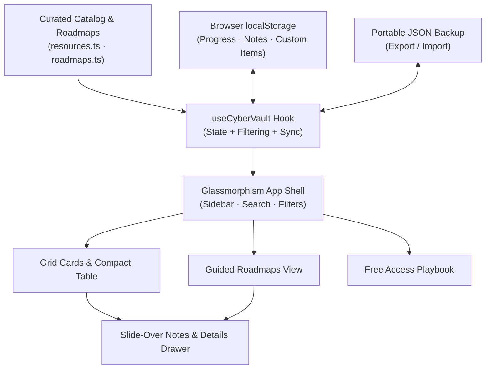

> [!NOTE]
> **56 verified free cybersecurity resources in one place:** organize free [TryHackMe](https://tryhackme.com/) rooms, [Hack The Box](https://www.hackthebox.com/) Starting Point &amp; Active Pool labs, top free CTFs, and essential security tools—without hitting paywalls.

<div align="center">

<h1>SecStudy</h1>

<p>
  
  
  
  
</p>

### A clean workspace to manage free TryHackMe rooms, Hack The Box labs, CTFs, and cybersecurity study roadmaps.

Track your progress, filter by platform or difficulty, save personal commands &amp; study notes, and follow guided zero-cost tracks from beginner to specialist. **100% free resources, 100% local privacy.**

<p><strong>Run SecStudy Locally</strong></p>

```bash
git clone https://github.com/jojin1709/SecStudy.git && cd SecStudy && npm install && npm run dev
```

<sub>Open <code>http://localhost:3000</code> in your browser to launch your workspace, or try the <a href="https://secstudy-free.vercel.app"><strong>Live App</strong></a>.</sub>

---

[](https://secstudy-free.vercel.app)&nbsp;&nbsp;[](https://github.com/jojin1709)

---

</div>

> [!TIP]
> **No paid subscription needed:** Use the built-in **Free Playbook** tab inside SecStudy to learn how to bypass TryHackMe's 1-hour AttackBox limit via OpenVPN and unlock Hack The Box's free Starting Point, Active Machines Pool, and 0-Cube Academy Tier 0 modules.

## Table of Contents

- [Table of Contents](#table-of-contents)
- [What is SecStudy?](#what-is-secstudy)
  - [Why SecStudy Exists](#why-secstudy-exists)
  - [Why Glassmorphism Instead of a Terminal Theme?](#why-glassmorphism-instead-of-a-terminal-theme)
  - [Who Is It Built For?](#who-is-it-built-for)
- [Curated Free Catalog](#curated-free-catalog)
- [Quick Start](#quick-start)
  - [Prerequisites](#prerequisites)
  - [Install &amp; Launch](#install--launch)
- [Key Capabilities](#key-capabilities)
- [Guided Study Roadmaps](#guided-study-roadmaps)
- [Architecture](#architecture)
- [Project Structure](#project-structure)
- [Privacy &amp; Data Persistence](#privacy--data-persistence)
- [Common Questions](#common-questions)
  - [Are all listed rooms and platforms actually free?](#are-all-listed-rooms-and-platforms-actually-free)
  - [Where are my notes and completed rooms stored?](#where-are-my-notes-and-completed-rooms-stored)
  - [Can I add my own TryHackMe rooms, HTB boxes, or CTF links?](#can-i-add-my-own-tryhackme-rooms-htb-boxes-or-ctf-links)
  - [How do I move my progress to another computer?](#how-do-i-move-my-progress-to-another-computer)

## What is SecStudy?

**SecStudy** is an open-source cybersecurity study organizer developed by **[JOJIN JOHN](https://github.com/jojin1709)**. Instead of juggling dozens of browser bookmarks across TryHackMe, Hack The Box, OverTheWire, PicoCTF, PortSwigger, and cheat-sheet wikis, SecStudy puts every verified free lab, CTF, and tool into a single searchable workspace.

Every resource includes its platform, category, difficulty level, free-tier access tip, and direct launch link—paired with local progress tracking (`Todo` / `In Progress` / `Completed`), bookmarks, and a slide-over notes drawer for your commands and writeups.

<a id="why-secstudy-exists"></a>
<details>
<summary><strong>Why SecStudy Exists</strong></summary>

Beginners and self-taught security learners often hit paywalls without realizing how much world-class training is completely free. Between TryHackMe's individual free rooms, Hack The Box's Starting Point &amp; Active Pool, and 100% free platforms like PortSwigger Web Security Academy, CryptoHack, and pwn.college, there is more free material than most learners know how to organize.

SecStudy curates those free resources accurately in one structured hub so you spend time learning instead of hunting for links.

</details>

<a id="why-glassmorphism-instead-of-a-terminal-theme"></a>
<details>
<summary><strong>Why Glassmorphism Instead of a Terminal Theme?</strong></summary>

Many cybersecurity tools default to dark matrix/cyberpunk themes that feel visually cluttered during long study sessions. SecStudy uses a clean, airy **Glassmorphism UI**—frosted translucent panels, crisp typography, and minimal cards—alongside both **Grid** and **Compact Table** views so scanning 50+ labs stays effortless.

</details>

<a id="who-is-it-built-for"></a>
<details>
<summary><strong>Who Is It Built For?</strong></summary>

- **Beginners** starting from zero with Linux, networking, and their first TryHackMe or OverTheWire challenges.
- **CTF players** tracking PicoCTF, CryptoHack, pwn.college, and weekend events on CTFtime.
- **Aspiring Pentesters &amp; SOC Analysts** following structured Red Team, Web AppSec, or Blue Team roadmaps without paying for subscriptions.

</details>

## Curated Free Catalog

SecStudy ships with **56 verified free resources** out of the box:

| Platform / Group | Count | Highlights Included | Free Access Model |
| --- | :---: | --- | --- |
| **TryHackMe** | 31 | OpenVPN, Linux 1–3, Windows 1–3, Networking, DNS, CyberChef, Burp Repeater, Pre Security &amp; Cyber 101 overviews, OhSINT, Pickle Rick, RootMe, Simple CTF, Bounty Hacker, Vulnversity, LazyAdmin, Kenobi, Blue, Ice, Mr. Robot CTF | Free rooms &amp; unlimited lab time via OpenVPN |
| **Hack The Box** | 8 | Starting Point Tier 0 (`Meow`, `Fawn`, `Dancing`, `Redeemer`, `Explosion`, `Preignition`), Tier 1–2 overview, Active Machines Pool, Active Challenges, HTB Academy Tier 0 (0-Cube) modules | Free account + OpenVPN / 0-Cube modules |
| **CTFs &amp; Wargames** | 9 | OverTheWire (`Bandit`, `Natas`), PicoCTF, PortSwigger Web Security Academy, CryptoHack, pwn.college, CTFtime, LetsDefend Free Tier, CyberDefenders | 100% free forever / Free tier |
| **Tools &amp; Cheat Sheets** | 8 | GTFOBins, LOLBAS, HackTricks, PayloadsAllTheThings, CyberChef, Online RevShell Generator, Burp Suite Community, Exploit-DB | 100% free open tools &amp; wikis |

## Quick Start

### Prerequisites

- **Node.js 20+** (LTS recommended) and **npm**
- **Git** (optional, if cloning via CLI)

### Install &amp; Launch

```bash
# 1. Clone the repository
git clone https://github.com/jojin1709/SecStudy.git
cd SecStudy

# 2. Install dependencies
npm install

# 3. Start the development server
npm run dev
```

Open **`http://localhost:3000`** in your browser.

For a production build:

```bash
npm run build
npm start
```

## Key Capabilities

- **Floating Sidebar &amp; Instant Search**: Filter by platform (`TryHackMe`, `Hack The Box`, `CTFs & Wargames`, `Tools & Docs`), workspace view (`Roadmaps`, `In Progress`, `Bookmarked`, `Free Playbook`), or press `/` to jump straight to instant search.
- **Grid &amp; Compact Table Views**: Switch between rich frosted resource cards and a high-density table view for scanning all labs at once.
- **Multi-Facet Filtering &amp; Sorting**: Filter by category (`Web Security`, `Linux & PrivEsc`, `Windows & AD`, `Cryptography`, `Binary & Pwn`, `Defensive & SOC`, etc.), difficulty (`Beginner` to `Hard`), and completion status.
- **Slide-Over Detail &amp; Notes Drawer**: Click any item to inspect its **Free Access Tip**, covered skills, status selector, bookmark toggle, and personal Markdown/command notes editor.
- **Custom Resource Manager**: Add your own TryHackMe rooms, HTB boxes, CTF events, or tools directly into your local vault.
- **JSON Backup &amp; Restore**: Export your entire progress, notes, bookmarks, and custom entries as a portable `.json` file and re-import anytime.

## Guided Study Roadmaps

SecStudy includes **5 interactive study tracks** that automatically compute your completion percentage as you check off resources:

| Roadmap | Target Role | Focus Areas |
| --- | --- | --- |
| **Zero-to-First-CTF Path** | Beginner / Junior Learner | OpenVPN setup, OverTheWire Bandit, Linux 1–3, Networking, HTB Tier 0, PicoCTF, Starter THM CTFs |
| **Web App Pentesting Track** | Web Pentester / Bug Bounty | Burp Suite Community, ffuf fuzzing, OverTheWire Natas, PortSwigger Academy, PayloadsAllTheThings |
| **Pentesting &amp; Boot2Root Track** | Penetration Tester | Windows Fundamentals, Nmap, HackTricks, GTFOBins, LOLBAS, THM &amp; HTB Active Boot2Root boxes |
| **Blue Team / SOC &amp; DFIR Track** | SOC Analyst / Responder | Defensive Security, Windows Event Logs, CyberChef, LetsDefend SIEM triage, CyberDefenders DFIR |
| **Crypto, Binary &amp; Competitive CTF Track** | CTF Player / Researcher | PicoCTF, CryptoHack (RSA/AES/ECC), pwn.college belts, HTB Challenges, CTFtime live events |

## Architecture

SecStudy runs as a fast, client-interactive Next.js App Router application with zero backend database dependencies—all curated data lives in typed modules and user state persists locally in the browser:



## Project Structure

| Path | Purpose |
| --- | --- |
| `src/app/page.tsx` | Main Glassmorphism workspace, sidebar navigation, search, filters, and Free Playbook |
| `src/app/layout.tsx` | Root Next.js layout, metadata, and Google Fonts (`Inter` &amp; `JetBrains Mono`) |
| `src/app/globals.css` | Ambient gradient backdrop and frosted `.glass-panel` / `.glass-card` styles |
| `src/data/resources.ts` | 56 curated free resources across TryHackMe, Hack The Box, CTFs, and tools |
| `src/data/roadmaps.ts` | 5 structured study roadmaps linked to catalog resource IDs |
| `src/hooks/useCyberVault.ts` | Local state management, `localStorage` persistence, custom resources, and JSON backup |
| `src/components/ResourceCard.tsx` | Frosted resource card component with status cycling and quick actions |
| `src/components/ResourceTable.tsx` | Compact table view for high-density resource scanning |
| `src/components/RoadmapView.tsx` | Interactive roadmap track cards with live progress bars |
| `src/components/ResourceDetailModal.tsx` | Slide-over inspector drawer for Free Access Tips, status, and personal notes |
| `src/components/AddResourceModal.tsx` | Modal form to add custom rooms, CTFs, or tools |
| `src/components/BackupModal.tsx` | JSON export, import, and local storage reset controls |
| `src/types/resource.ts` | Shared TypeScript interfaces for resources, roadmaps, and backups |

## Privacy &amp; Data Persistence

> [!IMPORTANT]
> SecStudy does **not** send your notes, progress, or custom resources to any external server. Everything stays inside your browser's `localStorage` (`cybervault_progress_v1` and `cybervault_custom_resources_v1`). Use **Backup / Import** in the sidebar to save a `.json` copy before clearing browser data.

## Common Questions

### Are all listed rooms and platforms actually free?

Yes. Every item in the catalog is accessible on a free account—either 100% free forever (PortSwigger, OverTheWire, PicoCTF, CryptoHack, pwn.college, GTFOBins, HackTricks) or via verified free-tier access (TryHackMe free rooms + OpenVPN, HTB Starting Point Tier 0–1, HTB Active Machines/Challenges, HTB Academy Tier 0 / 0-Cube modules).

### Where are my notes and completed rooms stored?

All status changes, bookmarks, study notes, and custom resources are saved automatically in your browser's `localStorage`.

### Can I add my own TryHackMe rooms, HTB boxes, or CTF links?

Yes. Click **Add Custom Resource** in the sidebar (or **Add** in the mobile header) to add any custom room, machine, CTF, or reference link with tags and difficulty.

### How do I move my progress to another computer?

Click **Backup / Import** in the bottom-left sidebar, export your `.json` backup file, and import it on your new device.

---

<div align="center">

**Built by [JOJIN JOHN](https://github.com/jojin1709)**

</div>
